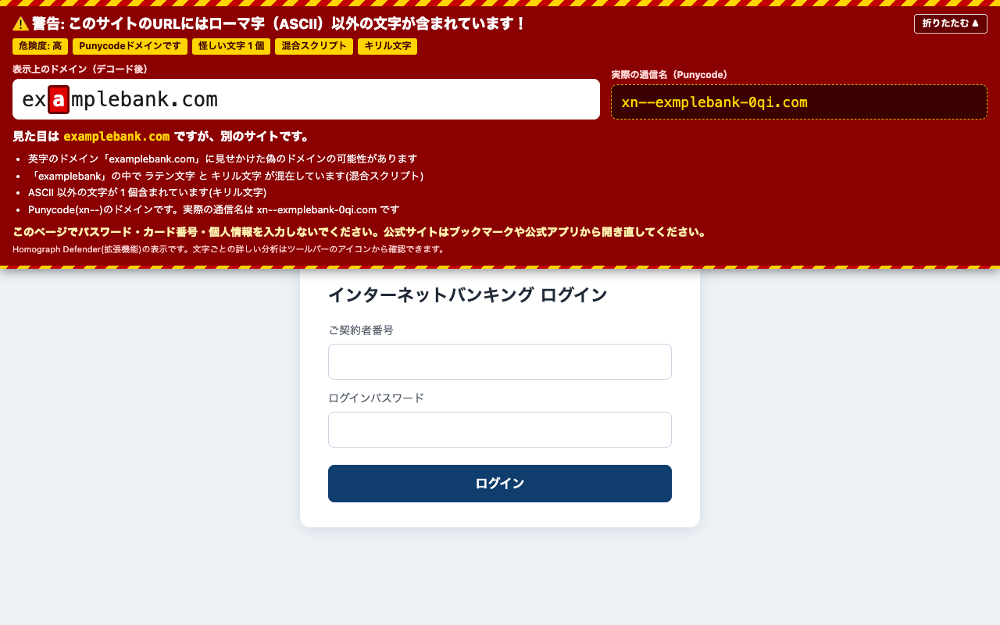
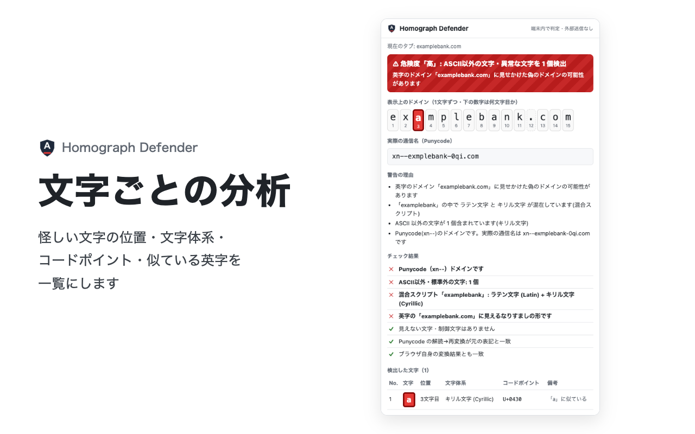
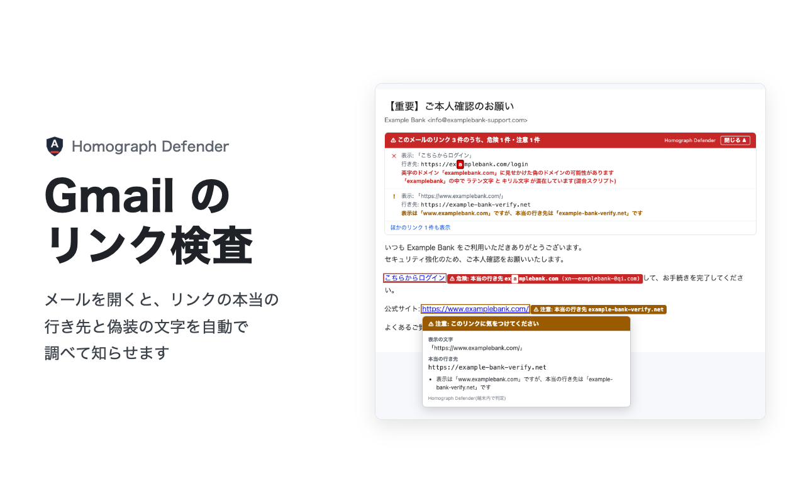

# Homograph Defender

URL のドメイン名やメールのリンクに、英字そっくりの別の文字(キリル文字の「а」、ギリシャ文字の「α」など)や見えない文字が紛れ込んでいないかを調べ、見つけたら赤く警告する Chrome 拡張機能です。判定はすべてブラウザの中で行い、外部へは何も送りません。



## できること

| | |
|---|---|
| ツールバーのバッジ | 英数字・ハイフン・ドットだけのドメインは緑の ✓、それ以外の文字や Punycode(`xn--`)があれば赤の ! |
| ページ上部の警告 | 怪しい文字を赤く強調したドメインと、実際の通信名(`xn--…`)を並べて表示。折りたたんでも細い帯は残る |
| 文字ごとの分析 | アイコンを押すと、ドメインを1文字ずつ表示し、怪しい文字の位置・文字体系・コードポイント(U+XXXX)・似ている英字を一覧にする。URL を貼り付けて調べることもできる |
| Gmail のリンク検査 | メールを開くと、本文の上にリンクの一覧と本当の行き先を表示。危険なリンクは枠で囲み、横に本当の行き先を出す。マウスを乗せると行き先と判定が出る |





## 見つけるもの

- ASCII 以外の文字(キリル・ギリシャ・アルメニア文字、全角英字、数学用英数字記号、囲み文字など)
- Punycode(`xn--`)のドメイン。解読して1文字ずつ調べ、再変換した結果とブラウザ自身の変換の両方と突き合わせる
- 1つのラベルに複数の文字体系が混ざっているもの(混合スクリプト。UTS #39 の考え方で、日本語・中国語・韓国語とラテン文字の組み合わせは通常とみなす)
- 全部の文字が英字に見えるよう作られたドメイン(例: すべてキリル文字の `аррӏе.com`)
- ゼロ幅スペースなどの見えない文字、文字の並びを入れ替える双方向制御文字、異体字セレクタ、結合文字、特殊スペース
- メールのリンクで、表示の文字(例: `www.example.com`)と本当の行き先が違うもの。Google・Outlook の転送用の URL は中の行き先を取り出して調べる
- 「@」より前を使った偽装、IP アドレスへのリンク、スラッシュに似た文字でパスに見せかける偽装

## プライバシー

- 判定はすべてブラウザの中で行う。URL・閲覧履歴・メールのリンク・貼り付けた文字を外部へ送らず、保存もしない
- 外部との通信をするコードは入っていない。拡張機能のページは CSP で `connect-src 'none'`
- Gmail で読むのは、開いたメールの中のリンクの行き先と表示の文字だけ
- アクセス解析・広告・外部のライブラリは使っていない(Punycode の変換も自前で実装)

## 権限

| 権限 | 使う理由 |
|---|---|
| `tabs` | 各タブの URL からドメイン名を読み取り、バッジに判定結果を出すため。サイトへのアクセスを「クリック時」に制限していてもバッジで警告できる |
| content scripts(`http://*/*`・`https://*/*`) | 疑わしいドメインのときだけ、ページ上部に警告を出すため。問題のないページには何も追加しない |
| content scripts(`https://mail.google.com/*`) | Gmail で開いたメールのリンクを調べるため |

## インストール

- Chrome ウェブストア: 審査中です。公開されたらここにリンクを載せます
- 手で読み込む場合: `chrome://extensions` → 右上の「デベロッパー モード」をオン →「パッケージ化されていない拡張機能を読み込む」→ このリポジトリの `extension` フォルダを選ぶ

## ファイル

| ファイル | 役割 |
|---|---|
| `extension/punycode.js` | RFC 3492 の Punycode の変換。不正な入力は寛容に読まず例外で止める |
| `extension/detector.js` | 1文字ずつの分類(Unicode の Script・一般カテゴリ・Default_Ignorable・Bidi_Control など)、混合スクリプト、英字への見せかけの判定 |
| `extension/links.js` | メールのリンクの判定(転送用 URL の取り出し・表示と行き先の食い違い) |
| `extension/background.js` | タブの URL が変わるたびにバッジを付ける |
| `extension/content.js` | ページ上部の警告。closed の Shadow DOM・最前面の層(popover)に出し、ページからの消去・非表示・上書きを見張って戻す |
| `extension/gmail.js` | Gmail の画面にリンクの一覧・印・説明を出す |
| `extension/popup.*` | 文字ごとの分析と、貼り付けての検査 |

画面に出す文字列はすべて `createElement` と `textContent` で組み立てています(`innerHTML`・`eval` は使っていません。テストで検査しています)。

## できないこと

- 調べるのは「ドメイン名の文字」と「リンクの表示と行き先の食い違い」です。英字だけで作られた偽サイトや、サイトの内容が安全かどうかは判定しません
- 短縮 URL(bit.ly など)は、外部に問い合わせないため短縮サービスのドメインまでを表示します
- 宣伝メールのクリック計測用のリンクなど、正規のメールでも表示と行き先が違うことがあります(「注意」として表示)
- 日本語ドメインなど正規の国際化ドメイン名でも、ASCII 以外の文字を含めば警告します(危険度「注意」)
- Gmail の検査はパソコンの Chrome で開く Gmail が対象です。Gmail の画面の作りが変わると、読めなくなることがあります

## 開発

```sh
npm install
npx playwright-core install chromium   # テストで拡張を読み込む Chromium
npm test                               # 単体テスト・静的検査・Chromium での通しの検品(画面の写しは tests/output/)
npm run zip                            # ストアに出す zip(extension フォルダの中身)
python3 tools/make-icons.py            # アイコンを描き直す(Pillow が必要)
```

テストは外部に接続しません。テスト用のドメインは、Playwright の route で手元のページを返しています。

## 不具合・脆弱性の報告

不具合は Issue へお願いします。脆弱性は公開の Issue ではなく info@utnoa.com へお知らせください。

## ライセンス

[MIT](LICENSE)。MIT で許諾しているのはコードの利用で、「Homograph Defender」の名前とアイコンは含みません。改変して配布するときは、別の名前とアイコンにしてください。

英字に見える文字の対応表(`extension/detector.js` の `CONFUSABLES`)は、Unicode の [confusables.txt](https://www.unicode.org/Public/security/latest/confusables.txt)(UTS #39)を参考に、ドメインの偽装でよく使われるものを抜き出したものです。

作成: [UTNOA](https://utnoa.com/)

---

## English summary

Homograph Defender is a Chrome extension (Manifest V3) that warns you in red when a domain name or an email link contains anything other than plain ASCII letters, digits, hyphens and dots: look-alike letters from other scripts (Cyrillic, Greek, etc.), Punycode (`xn--`), mathematical/full-width characters, zero-width and bidi control characters.

- Toolbar badge, a tamper-resistant warning banner at the top of the page, and a per-character analysis popup (script, code point, look-alike letter)
- Gmail: checks every link in the email you open, shows the real destination, and flags look-alike domains and links whose visible text differs from where they really go
- Everything runs locally. No network requests, no storage, no analytics, no third-party libraries
- Tests: `npm install && npx playwright-core install chromium && npm test`
- License: MIT (the name and icon are not covered)
